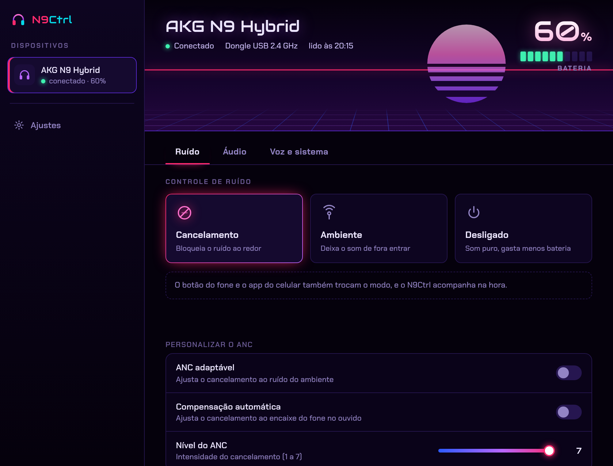
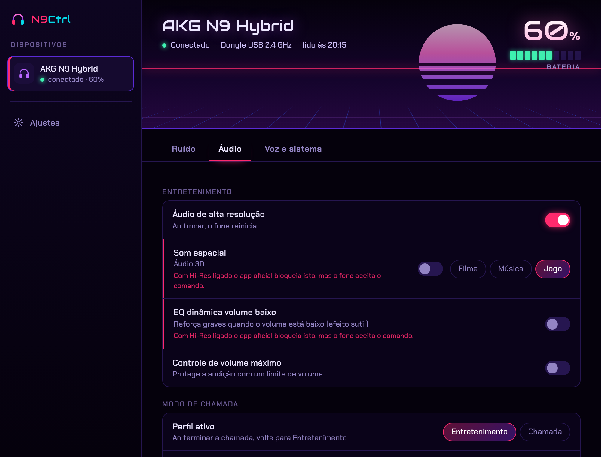
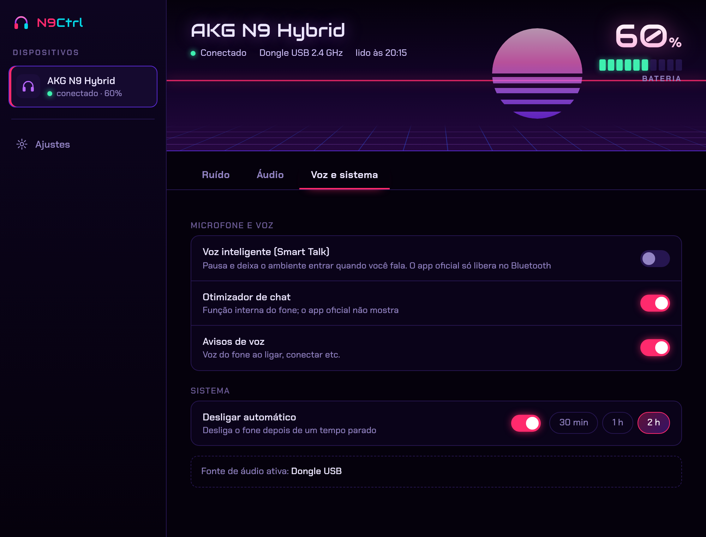

# N9Ctrl

**Control the AKG N9 Hybrid headphones from Windows, through the 2.4 GHz USB dongle.**

[Português (Brasil)](README.pt-BR.md)

The official AKG app only runs on phones. N9Ctrl is a small tray app for Windows 11 that talks
to the headset through the USB dongle it ships with, so you can change noise control and most
other settings without picking up your phone.

> **Unofficial project.** Not affiliated with, endorsed by or supported by AKG or HARMAN.
> "AKG" and "N9 Hybrid" are trademarks of their owners and are used only to describe
> compatibility. Use at your own risk.

## Features

- Noise control: ANC, Ambient and Off, plus ANC / ambient level sliders
- Adaptive ANC and auto compensation
- Left/right balance
- Hi-Res audio, spatial sound, low-volume dynamic EQ, max volume limit
- Call mode settings: profile, sound settings, voice settings, sound level optimizer
- Auto power-off, voice prompts, Smart Talk
- Battery level in the tray icon, low-battery notification
- Stays in sync: changes made with the headset buttons or the phone app show up within seconds
- Some features that the official app hides while Hi-Res is on (spatial sound, low-volume EQ)
  can be toggled — the headset accepts them

| Audio | Voice & system |
|---|---|
|  |  |

The interface is currently in Brazilian Portuguese.

## Requirements

- Windows 10 or 11 (with the WebView2 runtime, included in Windows 11)
- AKG N9 Hybrid with its USB dongle plugged in (the headset must be connected to the dongle)

## Install

**Option 1 — executable:** download `N9Ctrl.exe` from the
[Releases](../../releases) page and run it. Windows SmartScreen may warn about an unsigned app.

**Option 2 — from source:** install [Python 3.10–3.13](https://www.python.org/downloads/),
download this repository and double-click `run.bat`. The first run creates a virtual
environment and installs the dependencies. Use `run-debug.bat` to see errors in a console.

To build the executable yourself, run `run.bat` once and then `build.bat`
(output: `dist\N9Ctrl.exe`). Pushing a `v*` tag also builds it on GitHub Actions.

## How it works

The dongle exposes a vendor HID channel that carries Airoha **RACE** commands to the headset.
N9Ctrl uses [hidapi](https://github.com/trezor/cython-hidapi) for that channel,
[pywebview](https://pywebview.flowrl.com/) for the window and
[pystray](https://github.com/moses-palmer/pystray) for the tray icon.
The commands are documented in [docs/PROTOCOL.md](docs/PROTOCOL.md).

Settings and a small rotating log are kept in `%APPDATA%\N9Ctrl`.

## Safety

N9Ctrl only uses commands that were tested by setting a value, reading it back and restoring it.
It does **not** touch pairing, factory reset, firmware updates, gesture mapping or custom EQ
(those write to the headset's non-volatile memory). Changing Hi-Res audio restarts the headset;
the app asks before doing it.

## Not supported (yet)

- Custom 10-band EQ and EQ presets
- Left button cycle customization (gestures)
- Charging while listening — the headset turns audio off while charging; this is a firmware
  decision and is not controllable over the dongle
- Bluetooth-only features of the official app (auto play/pause, Smart Audio & Video)

## License

[MIT](LICENSE). Fonts in `ui/fonts` are under the SIL Open Font License 1.1.
