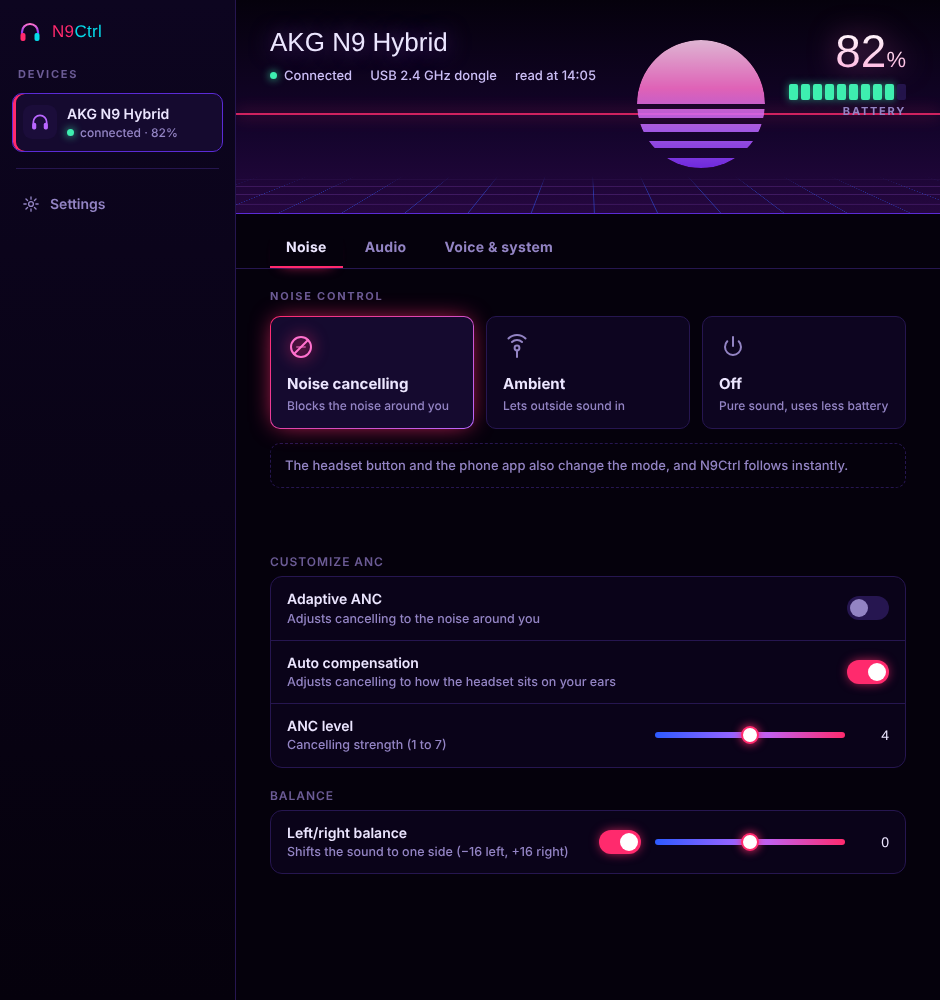
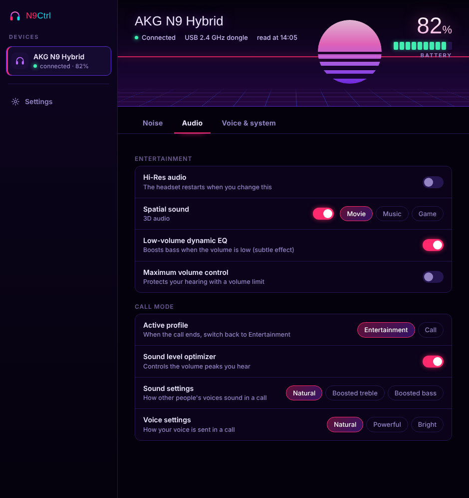
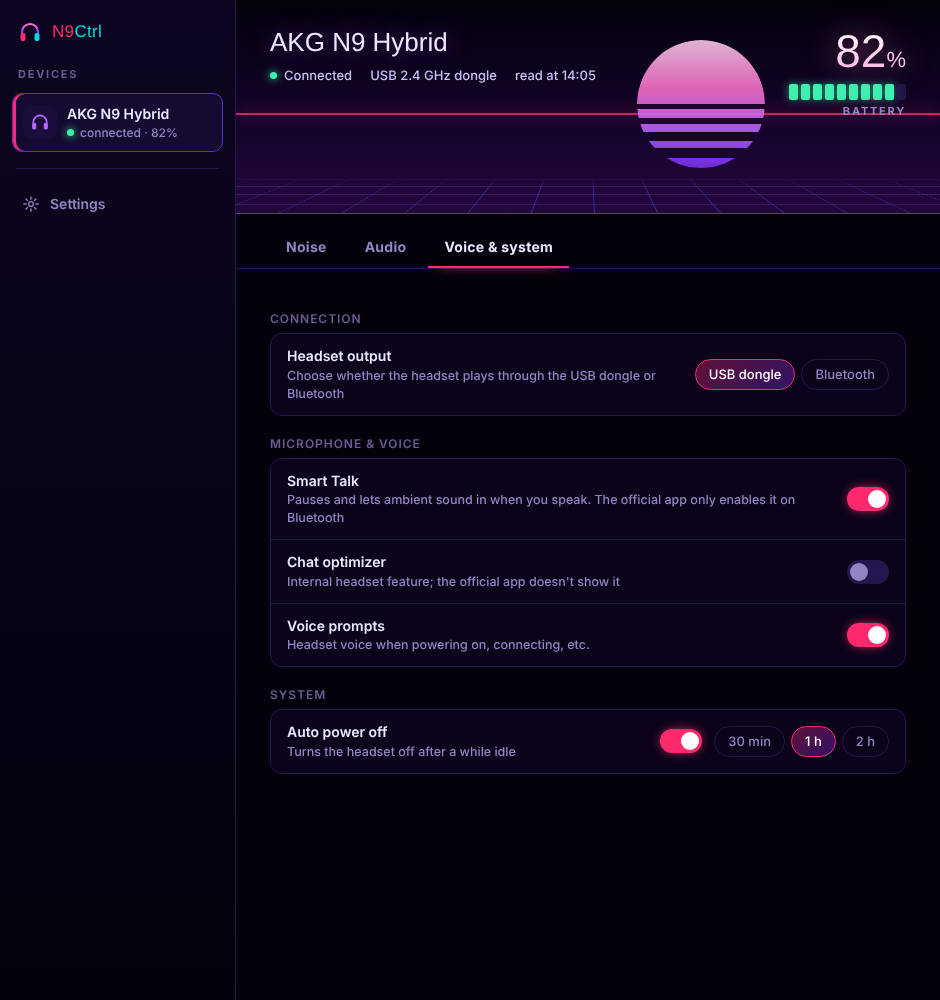

# N9Ctrl

**Controle o fone AKG N9 Hybrid pelo Windows, através do dongle USB 2.4 GHz.**

[English](README.md)

O app oficial da AKG só existe para celular. O N9Ctrl é um app leve de bandeja para Windows 11
que conversa com o fone pelo dongle que vem na caixa. Assim dá para trocar o controle de ruído e
a maioria das configurações sem pegar o celular.

> **Projeto não oficial.** Sem relação com a AKG ou a HARMAN, nem apoio delas.
> "AKG" e "N9 Hybrid" são marcas dos seus donos e aparecem aqui só para indicar compatibilidade.
> Use por sua conta e risco.

## Funções

- Controle de ruído: ANC, Ambiente e Desligado, com barras de nível do ANC e do ambiente
- ANC adaptável e compensação automática
- Equilíbrio esquerda/direita
- Áudio de alta resolução, som espacial, EQ dinâmica em volume baixo, controle de volume máximo
- Modo de chamada: perfil, definições de som, definições de voz, otimizador de nível sonoro
- Desligar automático, avisos de voz, Smart Talk
- Bateria no ícone da bandeja e aviso de bateria baixa
- Sincronizado: mudanças feitas pelos botões do fone ou pelo app do celular aparecem em segundos
- Funções que o app oficial esconde com o Hi-Res ligado (som espacial, EQ de volume baixo)
  podem ser usadas, porque o fone aceita os comandos

| Áudio | Voz e sistema |
|---|---|
|  |  |

A interface abre em inglês (padrão) e também existe em português: Ajustes → Idioma. O menu da bandeja acompanha. Os prints acima estão em inglês.

## Requisitos

- Windows 10 ou 11 (com o WebView2, que já vem no Windows 11)
- AKG N9 Hybrid com o dongle USB conectado (o fone precisa estar ligado ao dongle)

## Instalação

**Opção 1 — executável:** baixe o `N9Ctrl.exe` na página de [Releases](../../releases) e abra.
O SmartScreen do Windows pode avisar que o app não é assinado.

**Opção 2 — pelo código:** instale o [Python 3.10–3.13](https://www.python.org/downloads/),
baixe este repositório e dê dois cliques em `run.bat`. Na primeira vez ele cria o ambiente e
instala as dependências. Use `run-debug.bat` para ver erros num console.

Para gerar o executável, rode `run.bat` uma vez e depois `build.bat` (sai em `dist\N9Ctrl.exe`).
Criar uma tag `v*` no GitHub também gera o executável pelo GitHub Actions.

## Como funciona

O dongle tem um canal HID do fabricante que leva comandos **RACE** (Airoha) até o fone.
O N9Ctrl usa [hidapi](https://github.com/trezor/cython-hidapi) nesse canal,
[pywebview](https://pywebview.flowrl.com/) na janela e
[pystray](https://github.com/moses-palmer/pystray) no ícone da bandeja.
Os comandos estão documentados em [docs/PROTOCOL.md](docs/PROTOCOL.md) (em inglês).

As configurações e um log pequeno ficam em `%APPDATA%\N9Ctrl`.

## Segurança

O N9Ctrl só usa comandos testados mudando o valor, lendo de volta e restaurando.
Ele **não** mexe em pareamento, reset de fábrica, atualização de firmware, gestos nem EQ
personalizado (que gravam na memória permanente do fone). Trocar o Hi-Res reinicia o fone,
e o app pede confirmação antes.

## Ainda não suportado

- Equalizador de 10 bandas e presets de EQ
- Personalização do botão esquerdo (gestos)
- Usar enquanto carrega: o fone corta o áudio durante a carga; é uma decisão do firmware e não
  dá para controlar pelo dongle
- Funções só de Bluetooth do app oficial (pausa automática, Áudio & Vídeo Inteligente)

## Licença

[MIT](LICENSE). As fontes em `ui/fonts` usam a SIL Open Font License 1.1.
